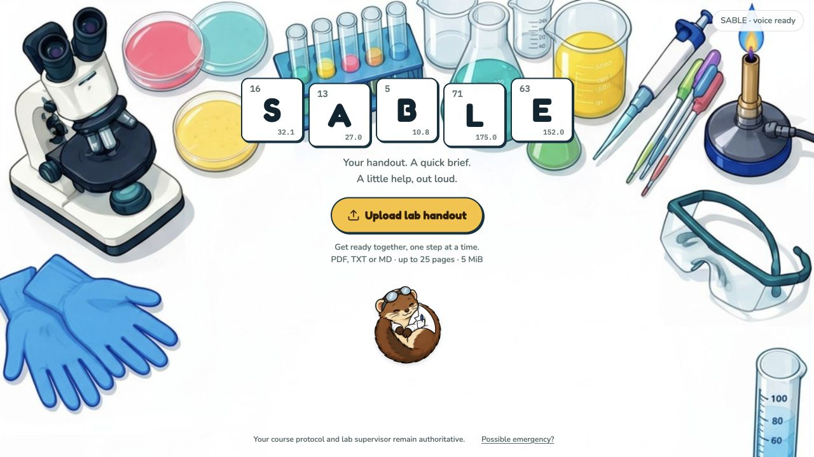

# Sable

**A conversational companion for the teaching lab.**

Upload your experiment handout and get ready with Sable. A cheerful voice walks you through general lab preparation, one item at a time, then explains the experiment's key warnings and concepts. During the experiment, ask questions out loud or type a reply. Sable helps you understand your work without grading you.



Built for the Shipyard Hackathon, October 2026. Repository: [rajjain-dev/labmate-ai](https://github.com/rajjain-dev/labmate-ai).

## The experience

1. **Upload a handout.** Select a PDF with selectable text, or a TXT/Markdown file.
2. **Get ready together.** Sable greets you immediately after the file is read. It covers hair/sleeves, eye protection, lab attire, and safety-equipment locations separately, waiting for your response each time. Say “yes,” “done,” or “not applicable”; ask a question whenever you need help.
3. **Hear the experiment briefing.** Sable reads the handout's precautions and verified online guidance, then gives the key points.
4. **Keep asking.** Spoken questions receive spoken answers. Typing is optional: choose **Type instead**, enter your response, and press **End turn**. The preparation sequence and conversation stay in place when switching modes.
5. **Inspect the sources.** PDF citations open the relevant handout page. Online references have their own source links.

The tabletop interface includes an animated Sable companion, readable controls, a conversation log, and a PDF viewer with page navigation and zoom. The upload screen fits one viewport; documents and conversations scroll within their panels.

## What powers it

- **xAI / Grok:** experiment explanations, conversational answers, and optional native web search.
- **ElevenLabs:** speech recognition and a human-selected cheerful companion voice. A prerecorded first greeting avoids waiting for a model or search request.
- **Source grounding:** PDF precautions must occur on their cited page. Web excerpts must appear in independently fetched pages from ACS, CDC, OSHA, PubChem, or RSC. Handout and web references have separate labels.
- **Next.js, React, and TypeScript:** one application with server-side provider adapters and strict Zod request/response schemas.
- **PDF.js / unpdf:** browser document viewing and bounded server text extraction.

```text
Handout upload → one-at-a-time preparation → warnings and key points
                                                    ↓
                                       spoken or typed questions
                                                    ↓
                         handout + verified web references → Grok
                                                    ↓
                                   answer + links + ElevenLabs voice
```

## Run locally

Use **Node.js 24** and npm.

```bash
git clone https://github.com/rajjain-dev/labmate-ai.git
cd labmate-ai
npm ci
cp .env.example .env.local
npm run dev -- --hostname 127.0.0.1 --port 3108
```

Open [Sable locally](http://127.0.0.1:3108). The default configuration is labeled sample mode. Configure the server-only values below for live conversation. Keep credentials in `.env.local`; never use `NEXT_PUBLIC_` for API keys.

| Setting | Purpose |
| --- | --- |
| `APP_MODE=live` | Use live providers. |
| `XAI_API_KEY`, `XAI_MODEL` | An xAI API key and a model available in your account. Web research requires native web-search support. |
| `ENABLE_WEB_RESEARCH=true` | Enable trusted-source web lookup with the same xAI credentials. |
| `REVIEW_SUPERVISED_DEMO=true` | Enable the supervised single-process model workflow. |
| `REVIEW_MAX_PROVIDER_CALLS=30` | Example hard allowance for model request attempts per process. |
| `ENABLE_VOICE=true`, `VOICE_SUPERVISED_DEMO=true` | Enable the supervised voice workflow. |
| `VOICE_MAX_PROVIDER_CALLS=30` | Example hard allowance for live speech/transcription attempts per process. |
| `ELEVENLABS_API_KEY` | ElevenLabs API access. |
| `ELEVENLABS_STT_MODEL`, `ELEVENLABS_TTS_MODEL` | Speech models available in your ElevenLabs account. |
| `ELEVENLABS_VOICE_ID` | A voice accessible to that account. The demo's selected custom voice ID is kept out of the repository. |

Browser microphone permission is required for spoken replies. Sable requests it after the first preparation prompt. Typing works without microphone access.

For a production build and local standalone server:

```bash
npm run build
HOSTNAME=127.0.0.1 PORT=3108 node --env-file=.env.local .next/standalone/server.js
```

The build prepares and packages the PDF worker and static assets. It excludes local environment files. Production hosts should inject secrets through their environment.

## Demo handout

The American Chemical Society's [Does Temperature Affect Dissolving? lesson plan](https://www.acs.org/content/dam/acsorg/msc/downloads/chapter-5/lesson-6/ch5-l6-lesson-plan.pdf) is a selectable-text example with a safety note on page 1. It is linked, not bundled. Follow the activity's instructions and your instructor's guidance.

## Boundaries and privacy

Sable supports supervised introductory teaching labs. General preparation is a reminder, not verification that equipment is suitable or that an experiment may begin. The course protocol, lab supervisor, and institutional procedures remain authoritative. Sable does not grade students, approve experiments, or guarantee outcomes. Incident reports receive fixed escalation guidance.

- **Uploads:** up to 5 MiB, 25 pages, and 24,000 extracted characters. Scanned PDFs without selectable text require OCR outside this MVP.
- **Voice:** turn-based, with a 2.2-second pause ending a spoken turn; recordings are bounded to 29 seconds and 5 MiB. Speaking over playback does not interrupt it. Use **End conversation** to stop; leaving the foreground also ends voice.
- **Data:** the application does not save uploaded PDFs or conversation history. They remain in the current page's memory. Handout text and recent conversation are sent to xAI; speech audio/text goes to ElevenLabs. This does not promise provider-side retention behavior.
- **Web search:** only fixed public experiment-topic labels enter search queries, not uploaded passages, filenames, or raw questions/history. Source excerpts are limited, linked, and verified against fetched pages. Lookup failures are labeled and fall back to the handout. The topic catalog currently focuses on introductory chemistry.
- **Usage:** web lookup and answer generation each consume a model attempt; native web tools can incur additional provider charges. In-memory rate/concurrency limits and attempt allowances support a supervised single process. Restarting resets allowances. Public/serverless live deployment needs shared limits.

## Project layout

| Path | Responsibility |
| --- | --- |
| `app/page.tsx`, `components/sable/` | Sable interface, PDF viewer, preparation and conversation state. |
| `components/voice/VoiceCoach.tsx` | Playback, microphone capture, pause detection, transcription, and voice turns. |
| `app/api/lab/`, `app/api/conversation/` | Document extraction and conversational guidance. |
| `app/api/transcribe/`, `app/api/speech/` | Bounded ElevenLabs endpoints. |
| `lib/providers/`, `lib/lab/` | Grok, web research, speech adapters, schemas, and preparation references. |
| `lib/harness/`, `app/api/review/` | Original structured review harness, retained for compatibility. |
| `docs/`, `coordination/` | Integration evidence, implementation decisions, and role contributions. |

## Delivery status

This is a local hackathon MVP. Production compilation and targeted live/browser checks are recorded in [the integration record](docs/SABLE_INTEGRATION.md) and [release status](docs/STATUS.md). Automated test suites were skipped at the owner's request; a complete human microphone conversation remains to be verified. Snowflake, camera monitoring, accounts, persistent history, and public hosting are outside this delivery.

See [MVP setup](docs/MVP.md), [voice integration](docs/VOICE_INTEGRATION.md), and [the decision register](coordination/DECISIONS.md) for technical details. Sable artwork and fixed audio provenance are documented under `public/sable/` and `public/audio/`.
